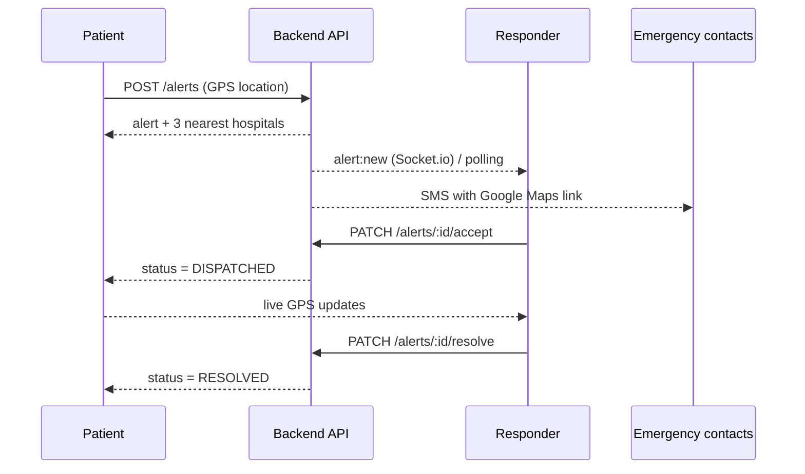

<div align="center">

# 🫀 CarePulse / MedVault — Frontend

**Unified Emergency Health Records & Smart Service Network**

Emergency QR medical profile · Live SOS dispatch · Appointments · Secure health records


</div>

---

## 📖 Overview

During a medical emergency, first responders often have no access to a patient's blood group, allergies or conditions, and ambulance dispatch, hospital data and records live in separate silos.

**CarePulse / MedVault** connects **patients, doctors, emergency responders and administrators** in a single platform. This repository is the **web client**. It talks to the [CarePulse Backend](https://github.com/ashrafulislam65/carepulse-backend) REST API and Socket.io server.

## ✨ Features

| Module | What it does |
|---|---|
| 🔲 **Emergency QR** | Signed, expiring QR link. Anyone can scan to see life-saving basics (blood group, allergies, conditions, emergency contacts). Full history needs a responder login or the patient's PIN. Links can be revoked instantly. |
| 🚨 **SOS dispatch** | One tap shares live location with responders and emergency contacts, and lists the nearest hospitals. Responders accept and resolve cases in real time. |
| 📁 **Records vault** | Upload prescriptions and lab reports (PDF/JPG/PNG) straight to private cloud storage via short-lived signed URLs. |
| 🩺 **Symptom triage** | Describe symptoms and get an urgency level (Emergency / Urgent / Non-urgent) with a clear next step. |
| 📅 **Appointments** | Conflict-free slot booking, live queue position and estimated wait time. |
| 💳 **Payments** | Stripe checkout for consultation fees and downloadable PDF invoices. |
| 🛡️ **Role based access** | Separate dashboards and route guards for Patient, Doctor, Responder and Admin. |
| 🎨 **Modern UI** | Animated landing page, glass navbar, split-screen auth, animated tab navigation, fully responsive. |

## 🧰 Tech Stack

| Layer | Technology |
|---|---|
| Framework | **Next.js 16** (App Router, Turbopack) |
| Language | **TypeScript** |
| UI library | **React 19** |
| Styling | **Tailwind CSS v4** (custom brand theme tokens) |
| Animation | **Motion** (`motion/react`) and CSS keyframes |
| Icons | **lucide-react** |
| Realtime | **socket.io-client** (with polling fallback) |
| State | React Context (auth) and local component state |
| Utilities | `clsx`, `tailwind-merge` |
| Fonts | Inter and Plus Jakarta Sans (`next/font`) |
| Hosting | **Vercel** |

## 🗂️ Folder Structure

```
carepulse-frontend/
├── public/
├── src/
│   ├── app/
│   │   ├── layout.tsx              # Root layout: fonts, AuthProvider, Navbar, AppShell
│   │   ├── template.tsx            # Page transition animation
│   │   ├── globals.css             # Tailwind import, brand theme, animations
│   │   ├── page.tsx                # Landing page
│   │   ├── login/page.tsx
│   │   ├── register/page.tsx
│   │   ├── triage/page.tsx         # Public symptom checker
│   │   ├── emergency/[code]/page.tsx   # Public QR page + PIN unlock
│   │   ├── patient/
│   │   │   ├── layout.tsx          # Tab navigation
│   │   │   ├── page.tsx            # Profile, contacts, PIN
│   │   │   ├── qr/page.tsx         # My QR, revoke
│   │   │   ├── sos/page.tsx        # SOS button + live tracking
│   │   │   ├── records/page.tsx    # Upload / view records
│   │   │   └── appointments/page.tsx
│   │   ├── doctor/page.tsx
│   │   ├── responder/page.tsx      # Live alerts dashboard
│   │   ├── admin/page.tsx          # Staff and hospital management
│   │   └── payments/{success,cancel}/page.tsx
│   ├── components/
│   │   ├── landing/                # Hero, Stats, Features, HowItWorks, Roles, Cta, SectionHeading
│   │   ├── ui.tsx                  # Button, Input, Select, Card, Alert, Badge, PageHeader
│   │   ├── Navbar.tsx
│   │   ├── Footer.tsx
│   │   ├── AppShell.tsx
│   │   ├── AuthShell.tsx           # Split-screen auth layout
│   │   ├── PatientNav.tsx
│   │   ├── RequireAuth.tsx         # Role based route guard
│   │   ├── Reveal.tsx              # Scroll reveal animation
│   │   └── CountUp.tsx             # Animated numbers
│   ├── context/
│   │   └── AuthContext.tsx         # Login, register, logout, current user
│   └── lib/
│       ├── api.ts                  # fetch wrapper, token handling, file download
│       ├── roles.ts                # Role -> home route
│       ├── types.ts
│       └── cn.ts                   # className merge helper
├── .env.example
├── next.config.ts
├── postcss.config.mjs
└── package.json
```

## 🔄 Complete Workflow

### 1. Patient journey

```
Register ─▶ Dashboard ─▶ Fill medical profile ─▶ Add emergency contacts ─▶ Set emergency PIN
                                                                                 │
                                                                                 ▼
                                      Get signed QR ◀──────────────── /patient/qr (download or print)
```

### 2. Emergency QR scan

```
Anyone scans QR
      │
      ▼
 /emergency/<signed-token>
      │
      ├── Public layer (no login): name, blood group, allergies, conditions, call buttons
      │
      └── Protected layer
            ├── Doctor / Responder / Admin login ──▶ "Show full medical history"
            └── Patient's PIN ──▶ 15 minute unlock token ──▶ full history
```

If the patient revokes the QR, the old link stops working immediately and a new one is generated.

### 3. SOS flow



The patient can cancel at any time. When two responders press *Accept* together, only one succeeds.

### 4. Appointment and payment flow

```
Pick doctor + date ─▶ Choose free slot ─▶ Booked (PENDING payment)
        │
        ├── Queue status (position, patients ahead, estimated wait)
        ├── Pay now ─▶ Stripe Checkout ─▶ webhook marks PAID
        ├── Invoice PDF download
        └── Doctor marks COMPLETED  /  Patient can CANCEL
```

### 5. Roles at a glance

| Role | Landing page after login | Main abilities |
|---|---|---|
| **Patient** | `/patient` | Profile, QR, PIN, SOS, records, appointments, payments |
| **Doctor** | `/doctor` | Own appointments, patient records, mark completed |
| **Responder** | `/responder` | Live alerts, accept / resolve, patient basics and location |
| **Admin** | `/admin` | Create staff users, manage hospitals |

## 🚀 Getting Started

### Prerequisites
- Node.js 20+
- The [backend](https://github.com/ashrafulislam65/carepulse-backend) running (default `http://localhost:5000`)

### Installation

```bash
git clone https://github.com/ashrafulislam65/carepulse-frontend.git
cd carepulse-frontend
npm install
cp .env.example .env.local
npm run dev
```

Open **http://localhost:3000**.

### Environment variables

| Variable | Example | Description |
|---|---|---|
| `NEXT_PUBLIC_API_URL` | `http://localhost:5000/api` | Base URL of the backend API (must end with `/api`) |

### Scripts

| Command | Description |
|---|---|
| `npm run dev` | Start the dev server |
| `npm run build` | Production build |
| `npm start` | Run the production build |
| `npm run lint` | Run ESLint |

### Demo accounts

After running the backend seed (password for all: `Password@123`):

| Role | Email |
|---|---|
| Doctor | `doctor@carepulse.test` |
| Responder | `responder@carepulse.test` |
| Admin | `admin@carepulse.test` |

Patients register themselves from `/register`.

## ☁️ Deployment (Vercel)

1. Import this repository in Vercel (framework: Next.js).
2. Add `NEXT_PUBLIC_API_URL` pointing to your deployed backend, for example `https://your-backend.vercel.app/api`.
3. Deploy, then set the backend's `FRONTEND_URL` to this site's URL and redeploy the backend (CORS and QR links).

> **Realtime note:** Vercel is serverless and does not keep WebSocket connections. The SOS and responder pages therefore poll every 5 seconds as a fallback. For true live GPS streaming, host the backend on a persistent server (Render, Railway, VPS) and only change `NEXT_PUBLIC_API_URL`.

## 🔐 Security notes

- Role based route guards on the client, enforced again on the server.
- JWT stored in `localStorage` (planned: httpOnly cookies).
- Emergency PIN attempts are rate limited by the backend.
- Medical files are never public. Downloads use 5 minute signed URLs.

## 🗺️ Roadmap

- [ ] Leaflet / OpenStreetMap live map for SOS and responder views
- [ ] Dark mode
- [ ] Dashboard stat cards and profile completion
- [ ] Calendar-style appointment picker
- [ ] httpOnly cookie authentication
- [ ] Local payment gateway (SSLCommerz / bKash)
- [ ] Bangla language support

## 🔗 Related

- Backend repository: [carepulse-backend](https://github.com/ashrafulislam65/carepulse-backend)

## ⚠️ Disclaimer

The symptom checker is an automated screening aid, not a medical diagnosis. In a life-threatening emergency, call your local emergency number first (999 in Bangladesh).

---

<div align="center">Built with ❤️ by <a href="https://github.com/ashrafulislam65">@ashrafulislam65</a></div>
